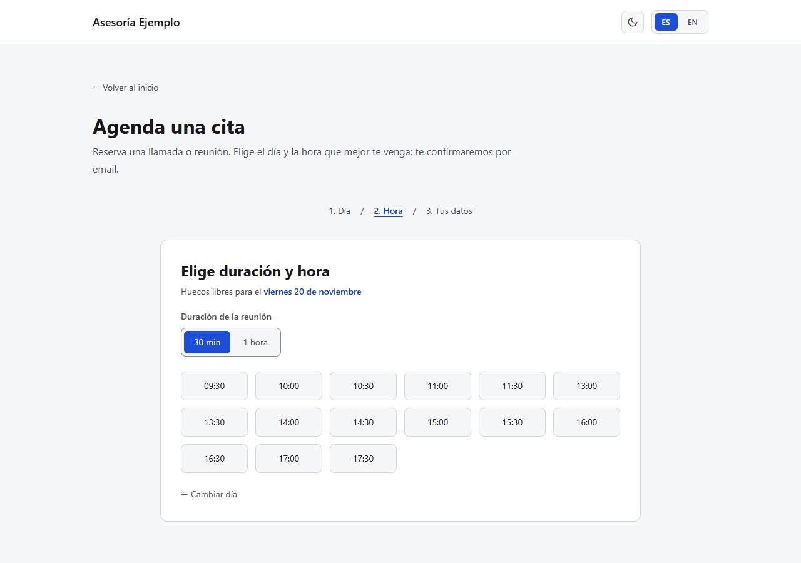
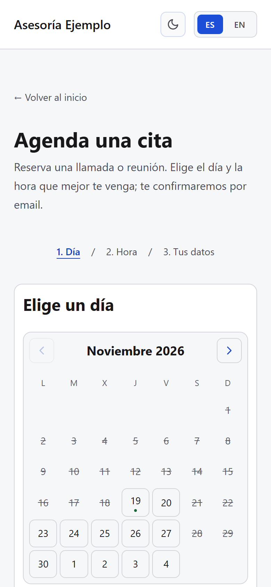
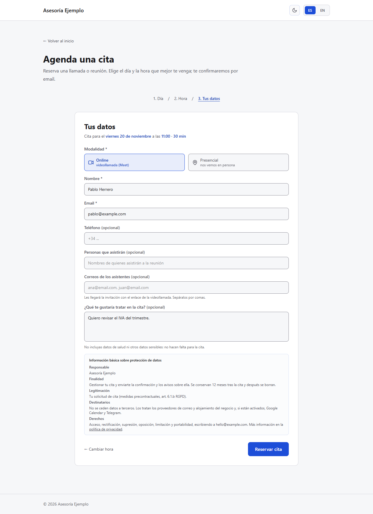
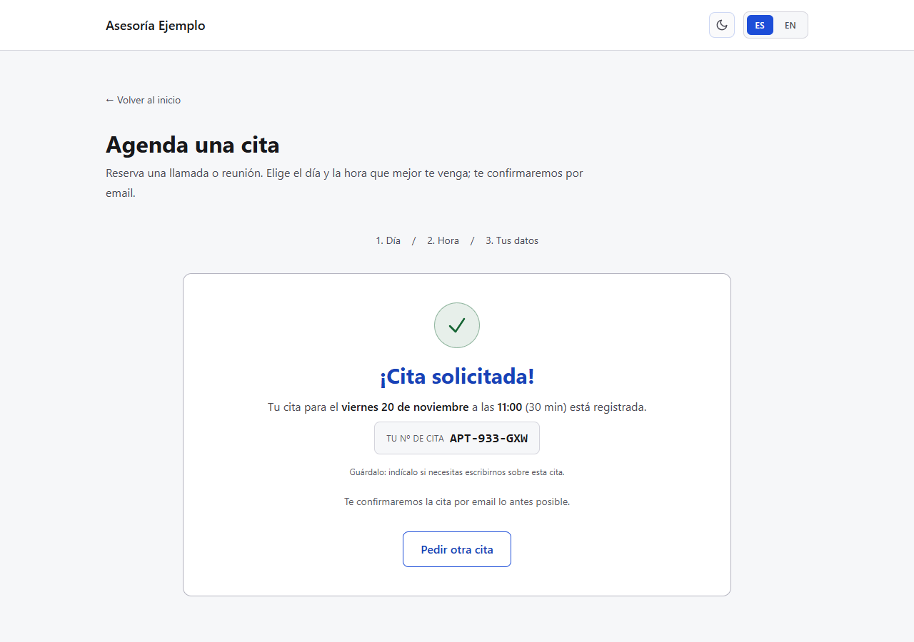
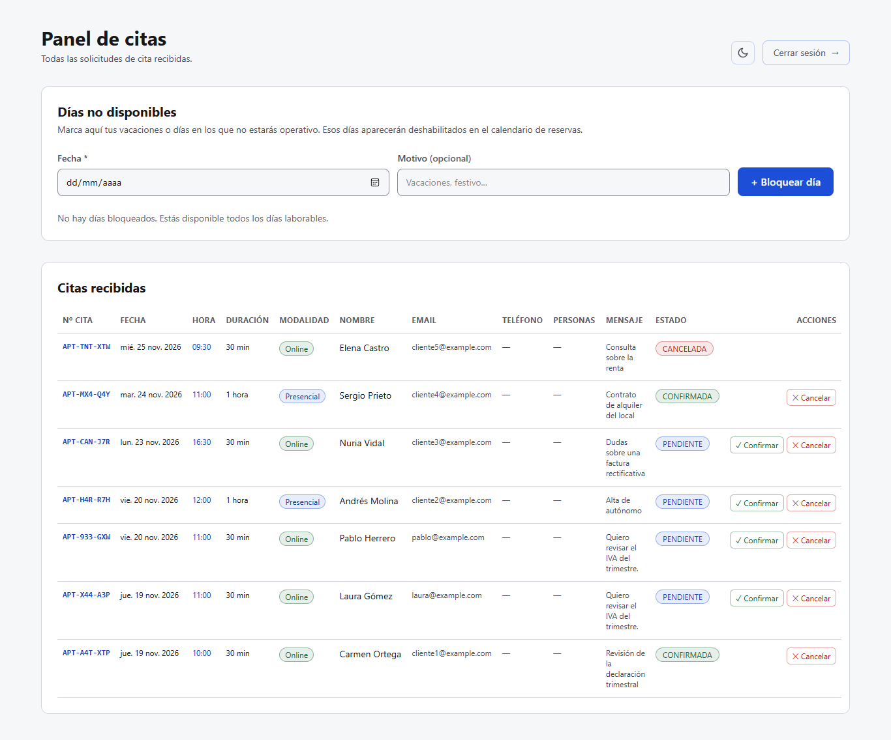
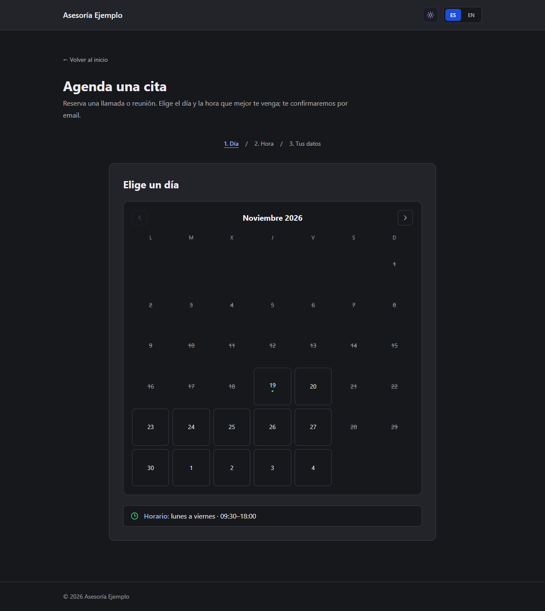

# Meetcita

**[Español](#español) | [English](#english)**

[](https://github.com/zeroit789/meetcita/actions/workflows/ci.yml)
[](LICENSE)




---

## Español

**Si tienes un negocio**

- [Qué es Meetcita](#qué-es-meetcita)
- [Qué hace por ti](#qué-hace-por-ti)
- [Cómo pide cita tu cliente](#cómo-pide-cita-tu-cliente)
- [Cómo gestionas las citas](#cómo-gestionas-las-citas)
- [Tus datos y los de tus clientes](#tus-datos-y-los-de-tus-clientes)
- [¿Cómo lo pongo en marcha?](#cómo-lo-pongo-en-marcha)

**Si eres desarrollador**

- [Stack y versiones](#stack-y-versiones)
- [Requisitos](#requisitos)
- [Instalación en local](#instalación-en-local)
- [Configuración (.env)](#configuración-env)
- [Despliegue en producción](#despliegue-en-producción)
- [Que los correos no acaben en spam: SPF, DKIM y DMARC](#que-los-correos-no-acaben-en-spam-spf-dkim-y-dmarc)
- [Docker](#docker)
- [Google Calendar + Meet (opcional)](#google-calendar--meet-opcional)
- [Bot de Telegram (opcional)](#bot-de-telegram-opcional)
- [Personalización](#personalización)
- [Eventos para enganchar tu CRM](#eventos-para-enganchar-tu-crm)
- [Modo demo](#modo-demo)
- [Comandos](#comandos)
- [Rutas](#rutas)
- [Estructura de carpetas](#estructura-de-carpetas)
- [Tests e integración continua](#tests-e-integración-continua)
- [Seguridad](#seguridad)
- [Limitaciones conocidas](#limitaciones-conocidas)
- [Licencia y créditos](#licencia-y-créditos)

### Qué es Meetcita

Meetcita es una página para que tus clientes te pidan cita por internet. Está pensada para asesorías, gestorías, consultas y despachos: negocios que atienden con cita previa, en persona o por videollamada.

El cliente elige día y hora en tu web y te deja sus datos. Tú recibes el aviso y decides si confirmas o no. El cliente recibe un correo en cada paso.

Es software libre (licencia MIT). No se paga una cuota por usuario ni por cita: se instala en tu propio servidor y los datos se quedan allí.

### Qué hace por ti

- **Solo ofrece las horas libres.** Respeta tu horario, tus días de trabajo y los días que bloquees (vacaciones, festivos). Si conectas tu Google Calendar, tampoco ofrece las horas en las que ya tienes algo.
- **No hay dos citas a la vez.** Aunque dos personas pulsen «Reservar» en el mismo segundo, solo una se queda con la hora.
- **Confirmas o rechazas desde el panel o desde el móvil.** El panel es una página privada con contraseña. Si quieres, también te llega cada cita por Telegram con dos botones.
- **El cliente recibe sus correos.** Uno al pedir la cita, otro cuando la confirmas (con el archivo para añadirla a su calendario) y otro si la cancelas, con el motivo si lo escribes.
- **El cliente cambia o cancela su cita él mismo.** Los correos llevan un enlace privado a «gestionar mi cita»: sin cuenta, puede cambiar el día y la hora o cancelarla hasta 24 horas antes (lo decides tú). Si la cambia, vuelve a quedar pendiente y la confirmas de nuevo. Pasado el plazo, la página le da tu contacto.
- **Recordatorio la víspera.** El día antes de cada cita confirmada le llega un correo con la hora, el botón para añadirla al calendario y el enlace para cambiarla o cancelarla. Menos citas olvidadas.
- **Tu horario de verdad.** Admite horario partido y distinto según el día (por ejemplo, de lunes a jueves mañana y tarde, y el viernes solo mañana). Ninguna cita cruza el descanso.
- **Videollamada automática (opcional).** Si conectas Google Calendar, cada cita online confirmada se crea en tu calendario con un enlace de Google Meet.
- **En español y en inglés.** La página y los correos salen en el idioma del cliente.
- **Con tu nombre y tu color.** El nombre del negocio, el horario, las duraciones y el color de los botones se cambian en la configuración.

### Cómo pide cita tu cliente

Son cuatro pasos y funciona igual en el móvil:

1. Elige el día en un calendario. Los días que no se pueden reservar salen tachados.
2. Elige cuánto dura la cita (por ejemplo, 30 minutos o 1 hora) y la hora.
3. Escribe su nombre y su correo. Teléfono, acompañantes y mensaje son opcionales. Justo encima del botón de reservar ve la información básica de protección de datos.
4. Recibe un código de cita, por ejemplo `APT-K7P-3QX`, que se lee y se dicta sin confusiones.

| Paso 1 en el móvil | Paso 3: datos y protección de datos |
|---|---|
|  |  |



### Cómo gestionas las citas

En el **panel** (`/panel`) ves todas las citas con su estado: pendiente, confirmada o cancelada. Desde ahí confirmas, cancelas (con un motivo opcional que le llega al cliente) y bloqueas los días en que no trabajas.

El panel abre en **Próximas** (de hoy en adelante). Con **Hoy** ves la agenda del día por horas y con **Todas**, el historial completo.

Si un cliente te llama por teléfono, das de **alta la cita a mano** con el botón «Nueva cita». Basta con el nombre; el correo y el teléfono son opcionales y, si no pones correo, no se envía nada. Solo te ofrece horas libres y la cita queda confirmada al guardarla.

Si activas `APPOINTMENTS_WHATSAPP_LINK`, cada cita con teléfono tiene un botón **WhatsApp** que abre la conversación con el cliente con su código de cita ya escrito.



Con el **bot de Telegram** (opcional) cada cita nueva te llega al móvil con dos botones: confirmar y rechazar. Si rechazas, el bot te pide el motivo y se lo envía al cliente.

La página tiene tema claro y oscuro. El cliente cambia con el botón del sol y la luna.



### Tus datos y los de tus clientes

- Todo se queda en tu servidor. No hay un servicio de terceros guardando tus citas. Google Calendar y Telegram solo se usan si tú los activas.
- El formulario muestra la primera capa de información del RGPD: responsable, finalidad, base legal, destinatarios y derechos, con enlace a tu política de privacidad. El texto legal final es responsabilidad de tu negocio: revísalo con quien te lleve la protección de datos.
- Cada noche se borran las citas que pasaron hace más de 12 meses. El plazo se puede cambiar o desactivar.
- Contra el spam lleva un captcha propio, sin servicios de terceros ni cookies de seguimiento: el navegador del cliente resuelve un pequeño cálculo antes de enviar. También limita las reservas por conexión y las citas activas de un mismo correo.

### ¿Cómo lo pongo en marcha?

Meetcita se instala en un servidor; no es una aplicación que se descarga y se abre. Hay dos caminos:

- **Te lo monta tu desarrollador o tu proveedor de hosting.** Todo lo técnico está más abajo, en la parte para desarrolladores.
- **Te lo monto yo.** Si no tienes a nadie, escríbeme desde [danimefle.com](https://danimefle.com) y lo vemos.

Necesitarás:

- un servidor o hosting con PHP 8.4 o superior (o con Docker);
- un dominio con HTTPS, por ejemplo `citas.tunegocio.es`;
- una cuenta de correo para enviar los avisos (los datos SMTP te los da tu proveedor de correo);
- si los quieres, una cuenta de Google (Calendar y Meet) y Telegram en el móvil.

---

### Stack y versiones

Versiones exactas de `composer.lock` y `pnpm-lock.yaml`:

| Pieza | Versión |
|---|---|
| PHP | ≥ 8.4.1 (`composer.json`; lo piden también los paquetes de Symfony 8 del lockfile) |
| laravel/framework | 13.43.0 |
| livewire/livewire | 4.4.8 |
| google/apiclient | 2.20.1 |
| altcha-org/altcha (captcha, servidor) | 2.4.0 |
| altcha (captcha, navegador) | 3.6.0 |
| laravel/tinker | 3.2.0 |
| laravel/pint (dev) | 1.32.3 |
| phpunit/phpunit (dev) | 13.4.8 |
| laravel/pail (dev) | 1.3.0 |
| tailwindcss / @tailwindcss/vite | 4.3.5 |
| vite | 8.3.8 |
| laravel-vite-plugin | 3.2.1 |
| concurrently (dev) | 10.0.7 |
| pnpm (`packageManager`) | 12.5.1 |

Base de datos: SQLite por defecto. También funciona con PostgreSQL y MySQL/MariaDB (ver [Limitaciones conocidas](#limitaciones-conocidas)).

### Requisitos

- **PHP 8.4.1 o superior**, con las extensiones habituales de Laravel y el driver PDO de tu base de datos (`pdo_sqlite` en la configuración por defecto).
- **Composer 2**.
- **Node.js 22.12+** (lo piden Vite 8 y concurrently 10) y **pnpm** (la versión está fijada en `packageManager` de `package.json`; con Corepack basta `corepack enable`).
- Opcional: un proyecto de **Google Cloud** (Calendar + Meet) y un **bot de Telegram**.

### Instalación en local

```bash
git clone https://github.com/zeroit789/meetcita.git meetcita
cd meetcita
composer setup
```

`composer setup` hace todo lo necesario: `composer install`, copia `.env.example` a `.env` si no existe, genera `APP_KEY`, crea la base de datos SQLite y las tablas (`migrate --force`), y ejecuta `pnpm install` y `pnpm run build`.

Después pon una contraseña en `APPOINTMENTS_PANEL_PASSWORD` dentro del `.env` y arranca:

```bash
composer dev        # servidor, cola, logs (Pail) y Vite a la vez
# o solo el servidor:
php artisan serve
```

Abre **http://localhost:8000/citas** para reservar y **http://localhost:8000/panel** para el panel. Con el `.env` de ejemplo los correos no se envían: se escriben en `storage/logs/laravel.log` (`MAIL_MAILER=log`).

Sin `pnpm run build` las páginas dan error 500, porque falta el manifiesto de Vite.

### Configuración (.env)

`.env.example` trae todas las variables comentadas. Ninguna de las propias es obligatoria para arrancar, pero sin contraseña no se puede entrar al panel. Se leen en `config/appointments.php`, `config/services.php` y `config/trustedproxy.php`.

**Laravel**

| Variable | Qué hace | Valor de ejemplo |
|---|---|---|
| `APP_NAME` | Nombre de la app (remitente de los correos). | `"Appointments"` |
| `APP_ENV` / `APP_DEBUG` | Entorno y errores detallados. En producción: `production` y `false`. | `local` / `true` |
| `APP_URL` | URL pública. En producción, tu dominio HTTPS (la usan los enlaces de los correos y el webhook de Telegram). | `http://localhost` |
| `APP_LOCALE` | Idioma interno de Laravel. No decide el idioma de la web de reservas (ver `default_locale` más abajo). | `es` |
| `TRUSTED_PROXIES` | IP o rangos CIDR del proxy inverso, separados por comas. Vacío = no confía en ninguno. `*` solo si la app es accesible únicamente a través del proxy. | *(vacío)*; en Coolify, `10.0.1.0/24` |
| `DB_CONNECTION` | `sqlite`, `pgsql` o `mysql`. | `sqlite` |
| `SESSION_DRIVER` | Dónde se guarda la sesión del panel. Usa `database`, `redis` o `file`; **nunca `cookie`** (ver [Seguridad](#seguridad)). | `database` |
| `QUEUE_CONNECTION` / `CACHE_STORE` | Cola de correos y caché (bloqueos, límites, retos del captcha). | `database` |
| `MAIL_MAILER` / `MAIL_FROM_ADDRESS` | Transporte y remitente. `log` escribe los correos en el log; en producción, `smtp` con los datos de tu proveedor. | `log` |

**Negocio y reservas**

| Variable | Qué hace | Por defecto |
|---|---|---|
| `APPOINTMENTS_BRAND` | Nombre del negocio (página, correos y eventos). | `"Acme Inc."` |
| `APPOINTMENTS_OWNER_NAME` / `APPOINTMENTS_OWNER_ROLE` | Nombre y cargo de la firma de los correos. | `"Jane Doe"` / `"Founder"` |
| `APPOINTMENTS_OWNER_EMAIL` | Recibe los avisos de cita nueva y es el Reply-To de los correos al cliente. | `"hello@example.com"` |
| `APPOINTMENTS_WEBSITE` / `APPOINTMENTS_LINKEDIN` | Enlaces de la firma. LinkedIn vacío = oculto. | `"https://example.com"` / *(vacío)* |
| `APPOINTMENTS_REF_PREFIX` | Prefijo del código de cita (2-4 letras). | `APT` |
| `APPOINTMENTS_ICS_UNSIGNED_UNTIL` | Solo si actualizas desde una versión anterior a la 1.0.0: los enlaces `.ics` sin firma ya enviados siguen valiendo para citas creadas antes de esta fecha (`YYYY-MM-DD`, pon el día en que actualizas). Vacío = ninguno. | *(vacío)* |
| `APPOINTMENTS_TIMEZONE` | Zona horaria del negocio. Todas las horas se calculan en ella. | `Europe/Madrid` |
| `APPOINTMENTS_DAYS_AHEAD` | Días laborables que se ofrecen. | `14` |
| `APPOINTMENTS_OPEN` / `APPOINTMENTS_CLOSE` | Apertura y cierre (el cierre es exclusivo: ninguna cita termina después). El texto del horario de la página sale de aquí. | `09:30` / `18:00` |
| `APPOINTMENTS_MAX_ATTENDEES` | Máximo de correos de invitados por cita. | `10` |
| `APPOINTMENTS_MAX_ACTIVE_PER_EMAIL` | Citas activas (sin cancelar, de hoy en adelante) que puede tener a la vez un mismo correo. `0` = sin tope. | `2` |
| `APPOINTMENTS_MODALITY_ONLINE` / `APPOINTMENTS_MODALITY_IN_PERSON` | Modalidades ofrecidas (al menos una a `true`). | `true` / `true` |
| `APPOINTMENTS_PANEL_PASSWORD` | Contraseña de `/panel`. No tiene valor por defecto. Cambiarla cierra todas las sesiones abiertas. | *(vacía: ponla tú)* |

**Horario, autogestión, recordatorios y WhatsApp**

| Variable | Qué hace | Por defecto |
|---|---|---|
| `APPOINTMENTS_HOURS` | Horario por día (opcional). Si tiene algo, manda él y `APPOINTMENTS_OPEN`/`APPOINTMENTS_CLOSE` y los días laborables se ignoran. Grupos separados por `;`: el día o rango ISO (1 = lunes … 7 = domingo) y sus tramos. Ejemplo: `"1-4 09:00-14:00 16:00-19:00; 5 09:00-14:00"` (lunes a jueves partido, viernes solo mañana). | *(vacío = apertura y cierre de lunes a viernes)* |
| `APPOINTMENTS_SELF_SERVICE` | Enlace «gestionar mi cita» en los correos al cliente para cambiar o cancelar su cita sin cuenta. `false` quita el enlace y la página. | `true` |
| `APPOINTMENTS_SELF_SERVICE_HOURS_BEFORE` | Horas mínimas antes de la cita para cambiarla o cancelarla en línea. `0` = hasta que empiece. | `24` |
| `APPOINTMENTS_PHONE` | Teléfono que ve el cliente cuando ya no puede cambiar su cita en línea. | *(vacío = solo el correo)* |
| `APPOINTMENTS_REMINDERS` | Correo de recordatorio la víspera de cada cita confirmada. Necesita el scheduler. | `true` |
| `APPOINTMENTS_REMINDERS_FROM` | Hora local a partir de la que sale el recordatorio (para no escribir de madrugada). | `09:00` |
| `APPOINTMENTS_WHATSAPP_LINK` | Botón de WhatsApp en el panel para las citas con teléfono. | `false` |
| `APPOINTMENTS_WHATSAPP_COUNTRY_CODE` | Prefijo de país que se añade a los teléfonos escritos sin `+` ni `00` (se quita un 0 inicial, salvo en Italia). Si el número no es válido, no sale el botón. | `34` |

**Privacidad (RGPD)**

| Variable | Qué hace | Por defecto |
|---|---|---|
| `APPOINTMENTS_PRIVACY_CONTROLLER` | Responsable del tratamiento que sale en la primera capa. | *(vacío = el nombre del negocio)* |
| `APPOINTMENTS_PRIVACY_URL` | Enlace a tu política de privacidad completa. | *(vacío = sin enlace)* |
| `APPOINTMENTS_PRIVACY_RECIPIENTS` | Destinatarios de los datos (proveedores). | *(vacío = texto genérico traducido)* |
| `APPOINTMENTS_RETENTION_MONTHS` | Meses que se guardan las citas pasadas; después, `citas:purgar` las borra cada noche a las 03:30. `0` = no borrar nunca. | `12` |

**Aspecto**

| Variable | Qué hace | Por defecto |
|---|---|---|
| `APPOINTMENTS_THEME` | Tema con el que se abre la página: `light`, `dark` o `auto` (el del sistema). El visitante puede cambiarlo. | `light` |
| `APPOINTMENTS_ACCENT` | Color de los botones, el día elegido y los enlaces, en hex `#rrggbb`. Lleva texto blanco encima: si no llega a un contraste de 4,5:1 con el blanco, se usa el de por defecto. **Entre comillas**: sin ellas, el `#` se lee como comentario. | `"#1d4ed8"` |
| `APPOINTMENTS_ACCENT_GLOW` | Opcional: tono claro del acento para los textos del tema oscuro. | *(vacío = se calcula solo)* |

**Integraciones, captcha y demo**

| Variable | Qué hace | Por defecto |
|---|---|---|
| `GOOGLE_CLIENT_ID` / `GOOGLE_CLIENT_SECRET` | Credenciales OAuth de Google (opcional). | *(vacío)* |
| `GOOGLE_REFRESH_TOKEN` | Lo da `php artisan google:auth`. | *(vacío)* |
| `GOOGLE_CALENDAR_ID` / `GOOGLE_REDIRECT_URI` | Calendario destino y URI de redirección OAuth. | `primary` / `http://localhost` |
| `TELEGRAM_BOT_TOKEN` / `TELEGRAM_CHAT_ID` | Bot y chat donde llegan los avisos (opcional). | *(vacío)* |
| `TELEGRAM_WEBHOOK_SECRET` | Cadena aleatoria que protege el webhook. Obligatoria si usas el bot. | *(vacío)* |
| `ALTCHA_ENABLED` | Captcha propio en la reserva. `false` lo quita (por ejemplo, en una intranet). | `true` |
| `ALTCHA_HMAC_KEY` | Clave HMAC propia del captcha. | *(vacío = deriva de `APP_KEY`)* |
| `MEETCITA_DEMO` | Convierte la instalación en una demo pública (ver [Modo demo](#modo-demo)). **Nunca en una instalación real.** | `false` |
| `MEETCITA_DEMO_PANEL_PASSWORD` | Contraseña del panel en modo demo. | `demo` |

Ajustes avanzados que no vienen en `.env.example`: `CSP_ENABLED` (pon `false` solo para depurar la CSP) y `ALTCHA_COST`, `ALTCHA_COUNTER_MIN`, `ALTCHA_COUNTER_MAX` y `ALTCHA_EXPIRES` (dificultad y vida del reto del captcha, en `config/services.php`).

Lo que no está en el `.env` se cambia en `config/appointments.php`:

- `schedule.durations`: duraciones que puede elegir el cliente, en minutos (por defecto `[30, 60]`). Valen otras, como 90 o 120, siempre que sean múltiplos del hueco: la cita no pisa la siguiente ni pasa del cierre.
- `schedule.slot_minutes`: tamaño del hueco (30).
- `schedule.weekdays`: días laborables en formato ISO (1 = lunes … 7 = domingo; por defecto, de lunes a viernes).
- `schedule.hours`: horario por día con varios tramos (lo mismo que `APPOINTMENTS_HOURS`, escrito como array): `[1 => [['09:00', '14:00'], ['16:00', '19:00']], 5 => [['09:00', '14:00']]]`. Los días que no aparecen están cerrados.
- `locales` y `default_locale`: idiomas. El de cada visita sale de la cookie del selector, si no del navegador (`Accept-Language`) y si no de `default_locale` (`es`).

### Despliegue en producción

1. `.env`: `APP_ENV=production`, `APP_DEBUG=false`, `APP_URL` con tu dominio HTTPS, una `APPOINTMENTS_PANEL_PASSWORD` larga y el correo SMTP de tu proveedor.
2. Dependencias y assets: `composer install --no-dev --optimize-autoloader`, `pnpm install --frozen-lockfile` y `pnpm run build`.
3. Tablas: `php artisan migrate --force`.
4. **Scheduler (obligatorio).** Los correos van en cola y el borrado de datos antiguos es una tarea programada. Sin el scheduler no sale ningún correo. Basta con una línea de cron:

   ```bash
   * * * * * cd /ruta/al/proyecto && php artisan schedule:run >> /dev/null 2>&1
   ```

   `routes/console.php` programa:
   - `queue:work --stop-when-empty --max-time=55 --tries=3` cada minuto (envía los correos);
   - `citas:purgar` cada día a las 03:30 (borra los datos caducados);
   - `citas:recordar` cada 15 minutos (recordatorio de la víspera; nunca sale dos veces);
   - `citas:demo` cada hora, **solo** con `MEETCITA_DEMO=true`.

   Si prefieres un worker permanente para la cola: `php artisan queue:work --tries=3`.
5. **HTTPS.** Sirve la web solo por HTTPS. La cabecera HSTS se envía cuando la petición llega por HTTPS.
6. **Proxy inverso.** Pon en `TRUSTED_PROXIES` la IP o el rango de tu proxy (en Coolify, `10.0.1.0/24`). Si lo dejas vacío detrás de un proxy, Laravel no verá la IP real ni el HTTPS del cliente, y el límite de reservas por IP se aplicará a la IP del proxy, común para todos.
7. **Sesiones en el servidor.** `SESSION_DRIVER=database` (el valor de `.env.example`), `redis` o `file`. No uses `cookie`.
8. **No cambies `APP_KEY`** una vez en marcha: firma los enlaces `.ics` y de «gestionar mi cita» de los correos, y con otra clave los enlaces ya enviados dejan de valer.
9. **Borrado de datos antiguos.** Está activado por defecto (12 meses). Si actualizas una instalación y quieres conservarlo todo, pon `APPOINTMENTS_RETENTION_MONTHS=0` **antes** de que corra el scheduler. Para ver qué se borraría: `php artisan citas:purgar --simular`.
10. **Telegram.** El webhook necesita HTTPS público. Tras el despliegue, ejecuta `php artisan telegram:set-webhook`.
11. **Correo que llegue a la bandeja de entrada.** Configura SPF, DKIM y DMARC en tu dominio (ver la sección siguiente). Sin ellos, los recordatorios y las confirmaciones acaban a menudo en spam.

### Que los correos no acaben en spam: SPF, DKIM y DMARC

Los recordatorios solo sirven si llegan a la bandeja de entrada. Los grandes proveedores de correo (Gmail, Outlook, Yahoo…) desconfían de los correos de un dominio que no demuestra que los envía él, y los mandan a spam o los rechazan. Se demuestra con tres registros DNS de tu dominio:

- **SPF** dice qué servidores pueden enviar correo en nombre de tu dominio. Es una lista de remitentes autorizados.
- **DKIM** firma cada correo con una clave privada que guarda tu proveedor de correo. La clave pública va en tu DNS y el que recibe comprueba que nadie ha tocado el mensaje por el camino.
- **DMARC** une los dos anteriores: le dice al que recibe qué hacer si un correo con tu dominio no pasa SPF ni DKIM (dejarlo pasar, mandarlo a spam o rechazarlo) y adónde enviarte informes.

`MAIL_FROM_ADDRESS` tiene que ser una dirección de **tu** dominio, el mismo de estos registros. Registros de ejemplo para `example.com` (los valores reales te los da tu proveedor SMTP):

```text
; SPF: un solo registro TXT en la raíz del dominio (si ya tienes uno, añade el include, no crees otro)
example.com.                       TXT  "v=spf1 include:_spf.proveedor-de-correo.example ~all"

; DKIM: el selector ("s1") y la clave pública los genera tu proveedor
s1._domainkey.example.com.         TXT  "v=DKIM1; k=rsa; p=MIIBIjANBgkqhkiG9w0BAQEFAAOCAQ8AMIIBCgKCAQEA..."

; DMARC: empieza en p=none (solo informes) y sube a quarantine o reject cuando todo pase
_dmarc.example.com.                TXT  "v=DMARC1; p=none; rua=mailto:dmarc@example.com"
```

**Cómo comprobarlo:**

1. Mira que los registros están publicados: `dig +short TXT example.com`, `dig +short TXT s1._domainkey.example.com` y `dig +short TXT _dmarc.example.com` (en Windows, `nslookup -type=TXT _dmarc.example.com`).
2. Pide una cita de prueba con un correo de Gmail y abre el mensaje con «Mostrar original»: SPF, DKIM y DMARC deben decir `PASS`.
3. En cualquier cliente, la cabecera `Authentication-Results` del correo recibido debe traer `spf=pass`, `dkim=pass` y `dmarc=pass`.

Cuando lleves unas semanas con todo en `pass` en los informes de DMARC, cambia `p=none` por `p=quarantine` (y más adelante `p=reject`) para que nadie pueda enviar correos falsos con tu dominio.

### Docker

> Probado el 23-11-2026 con la v1.0.0 en Ubuntu 24.04: la imagen se construye, la web arranca sana (`/up`), corre como `www-data` y el scheduler ejecuta las tareas. No se construye en la integración continua: revisa el resultado antes de llevarlo a producción.

El `Dockerfile` tiene tres etapas: compila el CSS y el JS con pnpm, instala las dependencias de PHP sin las de desarrollo y monta la imagen final con FrankenPHP (`dunglas/frankenphp:1.13.4-php8.5`, fijada por digest).

- Escucha en el puerto **8080** y corre como **`www-data`** (sin root).
- La base de datos SQLite va en **`/data/database.sqlite`**, dentro del volumen `datos`, fuera del código.
- Al arrancar, el contenedor crea el fichero de SQLite si falta, migra, cachea la configuración, las rutas y las vistas, y lanza el servidor.
- `compose.yaml` levanta dos servicios con la misma imagen: `web` (la página, con healthcheck en `/up`) y `scheduler` (`php artisan schedule:work`: cola de correos y borrado de datos antiguos). El scheduler espera a que la web esté sana y no migra.

Pasos (los de la cabecera de `compose.yaml`):

```bash
# 1. Crea el .env y rellénalo (marca, correo, contraseña del panel…)
cp .env.example .env
# 2. Construye la imagen
docker compose build
# 3. Genera la clave y pega el resultado en APP_KEY del .env
docker compose run --rm web php artisan key:generate --show
# 4. Arranca
docker compose up -d
```

La web queda en **http://localhost:8080**. Detrás de tu proxy (Caddy, Traefik, Coolify…) pon `TRUSTED_PROXIES`.

### Google Calendar + Meet (opcional)

Con Google conectado, cada cita confirmada se crea en tu calendario (con enlace de Meet si es online), se borra al cancelarla, y tus propios eventos bloquean las horas en que ya estás ocupado. Sin Google todo sigue funcionando, solo que sin sincronización ni Meet automático.

Guía paso a paso: [docs/GOOGLE.md](docs/GOOGLE.md).

### Bot de Telegram (opcional)

El bot te avisa de cada reserva con los botones **✅ Confirm** y **❌ Reject**. Al rechazar, te pide el motivo: tu siguiente mensaje (en menos de 15 minutos) cancela la cita y se envía al cliente. El aviso solo lleva el código, el nombre, el día y la hora. El webhook exige un secreto (403 si falta o no coincide) y solo atiende al chat del dueño. Sin bot, todo se gestiona desde `/panel`.

Guía paso a paso: [docs/TELEGRAM.md](docs/TELEGRAM.md).

### Personalización

- **Marca, horario y comportamiento**: variables del `.env` o `config/appointments.php` (cada opción está comentada).
- **Color**: `APPOINTMENTS_ACCENT` (y opcionalmente `APPOINTMENTS_ACCENT_GLOW`). No hace falta recompilar: el color llega a la página como variables CSS desde `resources/views/partials/theme-vars.blade.php`.
- **Tema por defecto**: `APPOINTMENTS_THEME`. Las paletas de cada tema están en `resources/css/app.css` (sección «SURFACES»); si las cambias, ejecuta `pnpm run build`.
- **Textos**: `lang/es/*.php` y `lang/en/*.php` (`citas.php` para la página, `emails.php` para los correos).
- **Página de inicio**: `resources/views/welcome.blade.php` es una portada de ejemplo; cámbiala por la tuya.
- **Incrustar en tu web con un iframe**: añade tu dominio a `frame-ancestors` en `config/csp.php`.

### Eventos para enganchar tu CRM

Cada cambio de una cita dispara un evento de Laravel. Con un *listener* puedes llevar las citas a tu CRM, a una hoja de cálculo o a donde quieras, sin tocar el código de Meetcita. Cada evento se dispara **una sola vez por cambio real** (si la cita ya estaba en ese estado, no se repite).

| Evento | Cuándo | Datos |
|---|---|---|
| `App\Events\AppointmentRequested` | Se crea una cita: desde la web (pendiente) o a mano en el panel. | `$appointment`, `$source` (`web` o `panel`) |
| `App\Events\AppointmentConfirmed` | Una cita pasa a confirmada: en el panel (también en el alta manual) o con el botón de Telegram. | `$appointment`, `$source` (`panel` o `telegram`) |
| `App\Events\AppointmentCancelled` | Una cita pasa a cancelada. | `$appointment`, `$cancelledBy` (`client`, `owner` o `telegram`), `$reason` (motivo o `null`) |
| `App\Events\AppointmentRescheduled` | El cliente cambia el día o la hora con su enlace (la cita vuelve a pendiente). | `$appointment` (ya con la fecha nueva), `$previousDate`, `$previousTime` |

`$appointment` es una **foto fija** de la cita en el momento del cambio (`App\Events\AppointmentSnapshot`), de solo lectura: `id`, `reference`, `date` (`"YYYY-MM-DD"`), `time` (`"HH:MM"`), `duration`, `status`, `modality`, `locale` y `revision`. **No lleva datos de contacto** (nombre, correo, teléfono, asistentes ni enlace de Meet), así no viajan por la cola. Si tu listener los necesita, carga la cita con `$evento->appointment->current()`: es la cita **actual** de la base de datos (puede haber cambiado después del evento) o `null` si ya no existe.

Ejemplo: enviar cada cita nueva a un CRM. Crea `app/Listeners/EnviarCitaAlCrm.php`; Laravel lo registra solo porque está en `app/Listeners` y el tipo del parámetro dice qué evento escucha:

```php
<?php

namespace App\Listeners;

use App\Events\AppointmentRequested;
use Illuminate\Contracts\Queue\ShouldQueue;
use Illuminate\Support\Facades\Http;

// ES: En cola (ShouldQueue): la llamada al CRM no hace esperar al cliente.
class EnviarCitaAlCrm implements ShouldQueue
{
    public function handle(AppointmentRequested $evento): void
    {
        $foto = $evento->appointment;      // ES: datos del momento del evento
        $cita = $foto->current();          // ES: la cita actual, con el contacto
        if ($cita === null) {
            return;                        // ES: ya se borró
        }

        Http::post('https://crm.example.com/api/leads', [
            'nombre' => $cita->name,
            'email' => $cita->email,
            'cita' => $foto->reference,
            'dia' => $foto->date,
            'hora' => $foto->time,
            'origen' => $evento->source,
        ]);
    }
}
```

Si un listener sin cola falla, el error se registra en el log (solo la clase de la excepción) y la cita sigue adelante: un CRM caído no rompe las reservas. Para trabajo lento o llamadas a otros servicios, usa `ShouldQueue` como en el ejemplo.

### Modo demo

`MEETCITA_DEMO=true` convierte la instalación en una demo pública:

- los correos van al log y no se envía ninguno;
- Telegram y Google quedan desactivados;
- sale un aviso de demo en las páginas;
- la contraseña del panel es `MEETCITA_DEMO_PANEL_PASSWORD` (`demo` por defecto) y se muestra en el login;
- cada hora el scheduler ejecuta `citas:demo`, que borra todas las citas y los días bloqueados y deja datos de ejemplo.

`citas:demo` se niega a ejecutarse fuera del modo demo y no borra nada. Aun así, **no actives nunca el modo demo en una instalación con clientes reales.**

### Comandos

| Comando | Para qué |
|---|---|
| `composer setup` | Instalación inicial completa (ver [Instalación en local](#instalación-en-local)). |
| `composer dev` | Servidor, cola, logs (Pail) y Vite a la vez. |
| `composer test` / `php artisan test` | Tests con PHPUnit. |
| `./vendor/bin/pint` | Formato del código PHP (preset de Laravel). |
| `pnpm run dev` / `pnpm run build` | Vite en desarrollo / compilación para producción. |
| `php artisan schedule:work` | Scheduler en primer plano (cola de correos cada minuto, purga nocturna). |
| `php artisan citas:purgar` | Borra las citas y los registros técnicos caducados. Con `--simular` solo cuenta lo que borraría. |
| `php artisan citas:recordar` | Envía el recordatorio a las citas confirmadas de mañana que aún no lo tienen (el scheduler la lanza cada 15 minutos). |
| `php artisan citas:demo` | Reinicia la demo con datos de ejemplo. Solo funciona con `MEETCITA_DEMO=true`. |
| `php artisan google:auth` | Paso 1 del OAuth de Google: imprime la URL de autorización. |
| `php artisan google:auth --code=CODIGO` | Paso 2: canjea el código e imprime el `GOOGLE_REFRESH_TOKEN`. |
| `php artisan telegram:set-webhook [--url=...]` | Registra el webhook del bot (por defecto `APP_URL/telegram/webhook`). |
| `php artisan telegram:test` | Envía un mensaje de prueba a tu chat. |

`citas:purgar` borra: las citas cuya fecha y último cambio tienen más de `APPOINTMENTS_RETENTION_MONTHS` meses (una cita futura nunca se borra), las sesiones sin actividad desde hace más de 30 días, las entradas de caché caducadas y los trabajos fallidos de la cola de más de 30 días. Fuera de la app quedan el buzón de correo, el chat de Telegram, los eventos de Google Calendar, los logs del proxy y las copias de seguridad.

### Rutas

| Método | Ruta | Qué hace |
|---|---|---|
| GET | `/` | Portada de ejemplo. |
| GET | `/citas` | Asistente de reserva. |
| GET | `/lang/{locale}` | Cambia el idioma (`es` / `en`). |
| GET | `/cita/{reference}/calendario.ics` | Descarga el `.ics` de una cita. Exige el enlace firmado de los correos (máximo 20 descargas por minuto e IP). |
| GET | `/cita/{reference}/gestionar` | «Gestionar mi cita»: ver, cambiar o cancelar. Exige el enlace firmado de los correos; la página solo muestra y las acciones van por POST (máximo 30 cargas por minuto e IP). |
| GET | `/altcha/challenge` | Reto del captcha, en JSON (máximo 30 por minuto e IP). |
| POST | `/telegram/webhook` | Webhook del bot (sin CSRF, protegido por secreto). |
| GET / POST | `/panel/login` | Login del panel (máximo 5 intentos por minuto e IP). |
| POST | `/panel/logout` | Cerrar sesión del panel. |
| GET | `/panel` | Panel de citas y días bloqueados. |
| GET | `/up` | Health check de Laravel. |

### Estructura de carpetas

```text
app/
├── Console/Commands/    google:auth, telegram:set-webhook, telegram:test, citas:purgar, citas:recordar, citas:demo
├── Events/              AppointmentRequested, AppointmentConfirmed, AppointmentCancelled, AppointmentRescheduled, AppointmentSnapshot (foto fija)
├── Http/Controllers/    PanelController, AppointmentIcsController, GestionarCitaController, TelegramWebhookController
├── Http/Middleware/     AdminPanelPassword (panel), SecurityHeaders (CSP y cabeceras), SetLocale (idioma)
├── Livewire/            BookAppointment (asistente), GestionarCita (gestionar mi cita), PanelCitas, PanelNuevaCita, PanelBlockedDays
├── Mail/                los correos de la cita, el recordatorio y los avisos al dueño (en cola)
├── Models/              Appointment, BlockedDay, User (del esqueleto, sin uso)
├── Services/            AvailabilityService, GestionCitas (cancelar, reprogramar, alta manual), CaptchaService, GoogleCalendarService, TelegramNotifier
└── Support/             Duracion, Eventos (disparo seguro), Horario (horario por día), ModoDemo
bootstrap/app.php        middleware, proxies de confianza, CSRF del webhook
config/appointments.php  configuración del sistema de citas
config/csp.php           directivas de la Content Security Policy
config/services.php      Telegram, Google y captcha
config/trustedproxy.php  proxies de confianza (TRUSTED_PROXIES)
database/migrations/     tablas base de Laravel + appointments + blocked_days
docker/entrypoint.sh     arranque del contenedor
docs/                    GOOGLE.md, TELEGRAM.md e img/
lang/{es,en}/            citas.php (interfaz) y emails.php (correos)
resources/css/app.css    Tailwind 4 y paletas de los temas
resources/js/            botón de tema y captcha
resources/views/         layouts, asistente, panel, partials y plantillas de correo
routes/web.php           rutas web
routes/console.php       tareas programadas (cola, recordatorios, purga, demo)
tests/                   tests unitarios y de funcionalidad
Dockerfile, compose.yaml imagen de producción y ejemplo con Docker Compose
.github/workflows/ci.yml integración continua (GitHub Actions)
```

### Tests e integración continua

```bash
php artisan test
```

Hay 146 tests. Usan SQLite en memoria, congelan el reloj en un día laborable fijo y apagan Google, Telegram y el captcha (la API de Google se simula con Mockery y la de Telegram con `Http::fake`), así que no necesitan red ni credenciales.

- **Unitarios** (`tests/Unit`): disponibilidad (días, huecos, duraciones, días bloqueados, horas pasadas, ocupación de Google), el servicio de Google Calendar y el modelo `Appointment`.
- **De funcionalidad** (`tests/Feature`): el asistente de reserva y la integridad de las reservas, el panel (acceso, seguridad de la sesión, confirmar, cancelar, días bloqueados), el webhook de Telegram, el idioma, el `.ics` firmado, los correos, el captcha, el modo demo, la purga, las cabeceras de seguridad, los proxies de confianza y el tema y la accesibilidad de las vistas.

El workflow `.github/workflows/ci.yml` se ejecuta en cada push y pull request con PHP 8.4 y 8.5: instala las dependencias, pasa Pint (`--test`), compila el front con pnpm, lanza los tests y ejecuta `composer audit` y `pnpm audit`. Las actions están fijadas por SHA. La imagen de Docker no se construye en CI.

### Seguridad

Para informar de una vulnerabilidad, **no abras un issue público**: sigue [SECURITY.md](SECURITY.md).

Lo que trae Meetcita:

- Content Security Policy con nonce por petición, sin scripts ni fuentes de terceros (`config/csp.php`), y cabeceras `X-Content-Type-Options`, `Referrer-Policy`, `Permissions-Policy`, `X-Frame-Options` y HSTS (solo por HTTPS).
- Panel con una sola contraseña, límite de intentos y sesión comprobada en cada petición de Livewire. Cerrar sesión invalida la sesión entera y cambiar la contraseña cierra todas las abiertas.
- La duración, el día y la hora de una reserva los fija el servidor. Sin dobles reservas: bloqueo por día, transacción que vuelve a comprobar el hueco y, en SQLite y PostgreSQL, un índice único parcial.
- Antispam: captcha propio (ALTCHA), campo trampa, máximo 5 reservas por hora e IP y tope de citas activas por correo.
- Enlaces `.ics` firmados. El secreto del webhook de Telegram se compara en tiempo constante.

Buenas prácticas al instalar: las de [SECURITY.md](SECURITY.md#buenas-prácticas-al-instalar-meetcita).

### Limitaciones conocidas

- **MySQL/MariaDB**: no admiten índices parciales, así que ahí no hay índice único en base de datos. La doble reserva la evitan solo el bloqueo y la transacción de la aplicación.
- Los mensajes del bot de Telegram están en español y sus botones en inglés. El error de contraseña del login del panel sale siempre en español.
- El enlace de «gestionar mi cita» va solo al titular (los asistentes reciben los correos aparte y sin él), caduca a la hora de la cita y deja de valer en cuanto la cita se cancela o se reprograma (con la cita nueva llega un enlace nuevo; si alguien abre uno viejo, ve una página que se lo explica). Mientras vale, quien lo tenga (por ejemplo, si el cliente lo reenvía) puede cambiar o cancelar la cita dentro del plazo. Si eso no encaja con tu negocio, pon `APPOINTMENTS_SELF_SERVICE=false`.
- Al reprogramar, el cliente solo puede elegir los días que ofrece la reserva pública y mantiene la duración de su cita; si esa duración ya no está en la config, la página le pide que te contacte. El alta manual del panel también ofrece solo esos días.
- Si tienes Google Calendar, al reprogramar se borra el evento viejo (Google avisa a los invitados de la cancelación) y se crea uno nuevo cuando vuelves a confirmar.
- El recordatorio sale **una vez por cita**: se marca justo antes de enviarlo, así dos procesos nunca lo mandan a la vez. Si el envío da error, se suelta y se reintenta 15 minutos después (con un corte de red justo cuando el servidor de correo ya lo había aceptado, podría llegar repetido). Si el servidor se cae entre marcar y enviar, esa cita se queda sin recordatorio. La copia de los asistentes se envía aparte y no se reintenta: si falla, solo queda en el log.
- Cada llamada a Google Calendar espera como mucho 10 segundos. Si Google crea el evento pero tarda más en responder, el evento queda en tu calendario sin enlazar con la cita (al cancelarla no se borra solo): bórralo a mano.
- Al confirmar una cita, Google envía la invitación a los asistentes en cuanto crea el evento. Si justo en ese momento el cliente cancela o cambia la cita, la invitación puede salir igualmente y, unos segundos después, su cancelación.
- El correo de «cita confirmada» comprueba, justo antes de salir de la cola, que la cita sigue confirmada y sin cambios. Si el cliente la cancela o la cambia en el instante exacto entre esa comprobación y el envío, el correo puede salir igualmente; después le llega el aviso del cambio.
- Los eventos de tu Google Calendar se redondean a la rejilla de huecos (cada 30 minutos desde las 00:00). Con tramos que no empiezan en un múltiplo del hueco (por ejemplo, 09:15), un evento corto puede bloquear también el hueco vecino.
- El uso único de cada solución del captcha depende de la caché compartida: con varios servidores, usa una caché común (`database`, que es la de por defecto, o `redis`).
- Docker: probado con la v1.0.0 (ver [Docker](#docker)); no se construye en la integración continua.

### Licencia y créditos

[MIT](LICENSE) © Daniel Castaños Mefle. Hecho por Daniel Castaños Mefle: [danimefle.com](https://danimefle.com).

---

## English

**If you run a business**

- [What Meetcita is](#what-meetcita-is)
- [What it does for you](#what-it-does-for-you)
- [How your clients book](#how-your-clients-book)
- [How you manage bookings](#how-you-manage-bookings)
- [Your data and your clients' data](#your-data-and-your-clients-data)
- [How do I get it running?](#how-do-i-get-it-running)

**If you are a developer**

- [Stack and versions](#stack-and-versions)
- [Requirements](#requirements)
- [Local installation](#local-installation)
- [Configuration (.env)](#configuration-env)
- [Production deployment](#production-deployment)
- [Keeping emails out of spam: SPF, DKIM and DMARC](#keeping-emails-out-of-spam-spf-dkim-and-dmarc)
- [Docker](#docker-1)
- [Google Calendar + Meet (optional)](#google-calendar--meet-optional)
- [Telegram bot (optional)](#telegram-bot-optional)
- [Customization](#customization)
- [Events to hook your CRM](#events-to-hook-your-crm)
- [Demo mode](#demo-mode)
- [Commands](#commands)
- [Routes](#routes)
- [Folder structure](#folder-structure)
- [Tests and CI](#tests-and-ci)
- [Security](#security)
- [Known limitations](#known-limitations)
- [License and credits](#license-and-credits)

### What Meetcita is

Meetcita is a web page where your clients book appointments with you online. It is made for advisory firms, accountants, practices and law offices: businesses that see people by appointment, in person or over a video call.

The client picks a day and a time on your site and leaves their details. You get notified and decide whether to confirm. The client gets an email at every step.

It is free software (MIT licence). There is no fee per user or per booking: it runs on your own server and the data stays there.

### What it does for you

- **It only offers free times.** It follows your hours, your working days and the days you block (holidays, days off). If you connect your Google Calendar, it also skips the times when you already have something on.
- **No two bookings at once.** Even if two people press "Book" in the same second, only one of them gets the time.
- **You confirm or reject from the panel or from your phone.** The panel is a private, password-protected page. If you want, every booking also reaches you on Telegram with two buttons.
- **The client gets their emails.** One when they book, another when you confirm (with a file to add it to their calendar) and another if you cancel, with the reason if you write one.
- **Clients change or cancel their own booking.** The emails carry a private "manage my booking" link: without an account, they can move it to another day and time or cancel it up to 24 hours before (you choose). If they change it, it goes back to pending and you confirm it again. After the deadline, the page shows your contact details.
- **Reminder the day before.** The day before each confirmed booking, the client gets an email with the time, the add-to-calendar button and the link to change or cancel it. Fewer forgotten bookings.
- **Your real opening hours.** Split hours and different hours per day (for example, Monday to Thursday morning and afternoon, and Friday mornings only). No booking crosses the break.
- **Automatic video calls (optional).** If you connect Google Calendar, every confirmed online booking is added to your calendar with a Google Meet link.
- **In Spanish and English.** The page and the emails use the client's language.
- **With your name and your colour.** The business name, the hours, the durations and the button colour are set in the configuration.

### How your clients book

It takes four steps and works the same on a phone:

1. They pick a day on a calendar. Days that can't be booked are crossed out.
2. They pick how long the meeting lasts (for example 30 minutes or 1 hour) and the time.
3. They enter their name and email. Phone, other attendees and a message are optional. Right above the booking button they see the basic data-protection information.
4. They get a booking code, for example `APT-K7P-3QX`, which is easy to read out without mix-ups.

| Step 1 on a phone | Step 3: details and data protection |
|---|---|
|  |  |


*The screenshots show the Spanish interface; the English one is the same.*

### How you manage bookings

The **panel** (`/panel`) lists every booking with its status: pending, confirmed or cancelled. From there you confirm, cancel (with an optional reason that is sent to the client) and block the days you don't work.

The panel opens on **Upcoming** (today onwards). **Today** shows the day's schedule by time and **All** the whole history.

When a client phones you, add the **booking by hand** with the "New booking" button. A name is enough; email and phone are optional and, without an email, nothing is sent. It only offers free times and the booking is confirmed when saved.

If you turn on `APPOINTMENTS_WHATSAPP_LINK`, every booking with a phone gets a **WhatsApp** button that opens the chat with the client, with their booking code already typed.


With the **Telegram bot** (optional) every new booking reaches your phone with two buttons: confirm and reject. If you reject, the bot asks for the reason and sends it to the client.

The page has a light and a dark theme. Clients switch with the sun and moon button.


### Your data and your clients' data

- Everything stays on your server. No third-party service stores your bookings. Google Calendar and Telegram are only used if you turn them on.
- The form shows the first layer of GDPR information: controller, purpose, legal basis, recipients and rights, with a link to your privacy policy. The final legal text is your business's responsibility: check it with whoever handles data protection for you.
- Every night, bookings that took place more than 12 months ago are deleted. The period can be changed or turned off.
- Spam is stopped by its own captcha, with no third-party services and no tracking cookies: the client's browser solves a small calculation before sending. It also limits bookings per connection and active bookings per email.

### How do I get it running?

Meetcita is installed on a server; it is not an app you download and open. There are two ways:

- **Your developer or hosting provider sets it up.** All the technical details are below, in the developer section.
- **I set it up for you.** If you have nobody to do it, get in touch through [danimefle.com](https://danimefle.com) and we'll look at it.

You will need:

- a server or hosting with PHP 8.4 or later (or with Docker);
- a domain with HTTPS, for example `booking.yourbusiness.com`;
- an email account to send the notifications (your email provider gives you the SMTP details);
- if you want them, a Google account (Calendar and Meet) and Telegram on your phone.

---

### Stack and versions

Exact versions from `composer.lock` and `pnpm-lock.yaml`:

| Component | Version |
|---|---|
| PHP | ≥ 8.4.1 (`composer.json`; also required by the Symfony 8 packages in the lockfile) |
| laravel/framework | 13.43.0 |
| livewire/livewire | 4.4.8 |
| google/apiclient | 2.20.1 |
| altcha-org/altcha (captcha, server) | 2.4.0 |
| altcha (captcha, browser) | 3.6.0 |
| laravel/tinker | 3.2.0 |
| laravel/pint (dev) | 1.32.3 |
| phpunit/phpunit (dev) | 13.4.8 |
| laravel/pail (dev) | 1.3.0 |
| tailwindcss / @tailwindcss/vite | 4.3.5 |
| vite | 8.3.8 |
| laravel-vite-plugin | 3.2.1 |
| concurrently (dev) | 10.0.7 |
| pnpm (`packageManager`) | 12.5.1 |

Database: SQLite by default. PostgreSQL and MySQL/MariaDB also work (see [Known limitations](#known-limitations)).

### Requirements

- **PHP 8.4.1 or later**, with the usual Laravel extensions and the PDO driver for your database (`pdo_sqlite` for the default setup).
- **Composer 2**.
- **Node.js 22.12+** (required by Vite 8 and concurrently 10) and **pnpm** (the version is pinned in `packageManager` in `package.json`; with Corepack, `corepack enable` is enough).
- Optional: a **Google Cloud** project (Calendar + Meet) and a **Telegram bot**.

### Local installation

```bash
git clone https://github.com/zeroit789/meetcita.git meetcita
cd meetcita
composer setup
```

`composer setup` does everything needed: `composer install`, copies `.env.example` to `.env` if it doesn't exist, generates `APP_KEY`, creates the SQLite database and the tables (`migrate --force`), and runs `pnpm install` and `pnpm run build`.

Then set a password in `APPOINTMENTS_PANEL_PASSWORD` in `.env` and start it:

```bash
composer dev        # server, queue, logs (Pail) and Vite together
# or just the server:
php artisan serve
```

Open **http://localhost:8000/citas** to book and **http://localhost:8000/panel** for the panel. With the example `.env`, emails are not sent: they are written to `storage/logs/laravel.log` (`MAIL_MAILER=log`).

Without `pnpm run build`, pages return a 500 error because the Vite manifest is missing.

### Configuration (.env)

`.env.example` lists every variable with comments. None of the project's own variables are required to boot, but you can't log in to the panel without a password. They are read in `config/appointments.php`, `config/services.php` and `config/trustedproxy.php`.

**Laravel**

| Variable | What it does | Example value |
|---|---|---|
| `APP_NAME` | App name (email sender name). | `"Appointments"` |
| `APP_ENV` / `APP_DEBUG` | Environment and detailed errors. In production: `production` and `false`. | `local` / `true` |
| `APP_URL` | Public URL. In production, your HTTPS domain (used by the email links and the Telegram webhook). | `http://localhost` |
| `APP_LOCALE` | Laravel's internal locale. It does not decide the booking site language (see `default_locale` below). | `es` |
| `TRUSTED_PROXIES` | Reverse proxy IPs or CIDR ranges, comma-separated. Empty = trust none. `*` only if the app can be reached exclusively through the proxy. | *(empty)*; on Coolify, `10.0.1.0/24` |
| `DB_CONNECTION` | `sqlite`, `pgsql` or `mysql`. | `sqlite` |
| `SESSION_DRIVER` | Where the panel session is stored. Use `database`, `redis` or `file`; **never `cookie`** (see [Security](#security)). | `database` |
| `QUEUE_CONNECTION` / `CACHE_STORE` | Email queue and cache (locks, limits, captcha challenges). | `database` |
| `MAIL_MAILER` / `MAIL_FROM_ADDRESS` | Mail transport and sender. `log` writes emails to the log; in production, `smtp` with your provider's details. | `log` |

**Business and bookings**

| Variable | What it does | Default |
|---|---|---|
| `APPOINTMENTS_BRAND` | Business name (page, emails and events). | `"Acme Inc."` |
| `APPOINTMENTS_OWNER_NAME` / `APPOINTMENTS_OWNER_ROLE` | Name and title in the email signature. | `"Jane Doe"` / `"Founder"` |
| `APPOINTMENTS_OWNER_EMAIL` | Gets the new-booking alerts and is the Reply-To of the client emails. | `"hello@example.com"` |
| `APPOINTMENTS_WEBSITE` / `APPOINTMENTS_LINKEDIN` | Signature links. Empty LinkedIn = hidden. | `"https://example.com"` / *(empty)* |
| `APPOINTMENTS_REF_PREFIX` | Booking code prefix (2-4 letters). | `APT` |
| `APPOINTMENTS_ICS_UNSIGNED_UNTIL` | Only when upgrading from a version before 1.0.0: unsigned `.ics` links already emailed keep working for bookings created before this date (`YYYY-MM-DD`, use the day you upgrade). Empty = none. | *(empty)* |
| `APPOINTMENTS_TIMEZONE` | Business time zone. All times are computed in it. | `Europe/Madrid` |
| `APPOINTMENTS_DAYS_AHEAD` | Number of business days offered. | `14` |
| `APPOINTMENTS_OPEN` / `APPOINTMENTS_CLOSE` | Opening and closing time (closing is exclusive: no meeting ends after it). The page's schedule text comes from here. | `09:30` / `18:00` |
| `APPOINTMENTS_MAX_ATTENDEES` | Max guest emails per booking. | `10` |
| `APPOINTMENTS_MAX_ACTIVE_PER_EMAIL` | Active bookings (not cancelled, from today on) one email may hold at once. `0` = no cap. | `2` |
| `APPOINTMENTS_MODALITY_ONLINE` / `APPOINTMENTS_MODALITY_IN_PERSON` | Meeting types offered (at least one must be `true`). | `true` / `true` |
| `APPOINTMENTS_PANEL_PASSWORD` | Password for `/panel`. There is no default. Changing it closes every open session. | *(empty: set one)* |

**Hours, self-service, reminders and WhatsApp**

| Variable | What it does | Default |
|---|---|---|
| `APPOINTMENTS_HOURS` | Per-day hours (optional). If set, it wins and `APPOINTMENTS_OPEN`/`APPOINTMENTS_CLOSE` and the working days are ignored. Groups split by `;`: the ISO day or range (1 = Monday … 7 = Sunday) and its ranges. Example: `"1-4 09:00-14:00 16:00-19:00; 5 09:00-14:00"` (Monday to Thursday split, Friday mornings only). | *(empty = open and close, Monday to Friday)* |
| `APPOINTMENTS_SELF_SERVICE` | "Manage my booking" link in the client emails to change or cancel without an account. `false` removes the link and the page. | `true` |
| `APPOINTMENTS_SELF_SERVICE_HOURS_BEFORE` | Minimum hours before the booking to change or cancel it online. `0` = until it starts. | `24` |
| `APPOINTMENTS_PHONE` | Phone the client sees when they can no longer change their booking online. | *(empty = email only)* |
| `APPOINTMENTS_REMINDERS` | Reminder email the day before each confirmed booking. Needs the scheduler. | `true` |
| `APPOINTMENTS_REMINDERS_FROM` | Local time from which the reminder goes out (so as not to write at night). | `09:00` |
| `APPOINTMENTS_WHATSAPP_LINK` | WhatsApp button in the panel for bookings with a phone. | `false` |
| `APPOINTMENTS_WHATSAPP_COUNTRY_CODE` | Country prefix added to phones written without `+` or `00` (one leading 0 is dropped, except in Italy). If the number isn't valid, the button isn't shown. | `34` |

**Privacy (GDPR)**

| Variable | What it does | Default |
|---|---|---|
| `APPOINTMENTS_PRIVACY_CONTROLLER` | Data controller shown in the first-layer notice. | *(empty = the business name)* |
| `APPOINTMENTS_PRIVACY_URL` | Link to your full privacy policy. | *(empty = no link)* |
| `APPOINTMENTS_PRIVACY_RECIPIENTS` | Data recipients (providers). | *(empty = generic translated text)* |
| `APPOINTMENTS_RETENTION_MONTHS` | Months past bookings are kept; after that, `citas:purgar` deletes them every night at 03:30. `0` = never delete. | `12` |

**Look and feel**

| Variable | What it does | Default |
|---|---|---|
| `APPOINTMENTS_THEME` | Theme the page opens with: `light`, `dark` or `auto` (the system's). Visitors can switch. | `light` |
| `APPOINTMENTS_ACCENT` | Colour of the buttons, the chosen day and the links, as `#rrggbb` hex. White text goes on top: if it doesn't reach a 4.5:1 contrast against white, the default is used. **Keep the quotes**: without them, the `#` is read as a comment. | `"#1d4ed8"` |
| `APPOINTMENTS_ACCENT_GLOW` | Optional: light shade of the accent for text in the dark theme. | *(empty = derived automatically)* |

**Integrations, captcha and demo**

| Variable | What it does | Default |
|---|---|---|
| `GOOGLE_CLIENT_ID` / `GOOGLE_CLIENT_SECRET` | Google OAuth credentials (optional). | *(empty)* |
| `GOOGLE_REFRESH_TOKEN` | Printed by `php artisan google:auth`. | *(empty)* |
| `GOOGLE_CALENDAR_ID` / `GOOGLE_REDIRECT_URI` | Target calendar and OAuth redirect URI. | `primary` / `http://localhost` |
| `TELEGRAM_BOT_TOKEN` / `TELEGRAM_CHAT_ID` | Bot and chat that receive the alerts (optional). | *(empty)* |
| `TELEGRAM_WEBHOOK_SECRET` | Random string that protects the webhook. Required if you use the bot. | *(empty)* |
| `ALTCHA_ENABLED` | Own captcha on the booking form. `false` removes it (for example, on an intranet). | `true` |
| `ALTCHA_HMAC_KEY` | Own HMAC key for the captcha. | *(empty = derived from `APP_KEY`)* |
| `MEETCITA_DEMO` | Turns the install into a public demo (see [Demo mode](#demo-mode)). **Never on a real installation.** | `false` |
| `MEETCITA_DEMO_PANEL_PASSWORD` | Panel password in demo mode. | `demo` |

Advanced settings not in `.env.example`: `CSP_ENABLED` (set `false` only to debug the CSP) and `ALTCHA_COST`, `ALTCHA_COUNTER_MIN`, `ALTCHA_COUNTER_MAX` and `ALTCHA_EXPIRES` (captcha challenge difficulty and lifetime, in `config/services.php`).

Anything not in `.env` is changed in `config/appointments.php`:

- `schedule.durations`: durations the client can pick, in minutes (`[30, 60]` by default). Others such as 90 or 120 work too, as long as they are multiples of the slot: the booking neither overlaps the next one nor runs past closing time.
- `schedule.slot_minutes`: slot length (30).
- `schedule.weekdays`: business days in ISO format (1 = Monday … 7 = Sunday; Monday to Friday by default).
- `schedule.hours`: per-day hours with several ranges (the same as `APPOINTMENTS_HOURS`, written as an array): `[1 => [['09:00', '14:00'], ['16:00', '19:00']], 5 => [['09:00', '14:00']]]`. Days not listed are closed.
- `locales` and `default_locale`: languages. Each visit's language comes from the switcher cookie, then the browser (`Accept-Language`), then `default_locale` (`es`).

### Production deployment

1. `.env`: `APP_ENV=production`, `APP_DEBUG=false`, `APP_URL` set to your HTTPS domain, a long `APPOINTMENTS_PANEL_PASSWORD` and your provider's SMTP settings.
2. Dependencies and assets: `composer install --no-dev --optimize-autoloader`, `pnpm install --frozen-lockfile` and `pnpm run build`.
3. Tables: `php artisan migrate --force`.
4. **Scheduler (required).** Emails are queued and the old-data purge is a scheduled task. Without the scheduler, no email goes out. A single cron line is enough:

   ```bash
   * * * * * cd /path/to/project && php artisan schedule:run >> /dev/null 2>&1
   ```

   `routes/console.php` schedules:
   - `queue:work --stop-when-empty --max-time=55 --tries=3` every minute (sends the emails);
   - `citas:purgar` every day at 03:30 (deletes expired data);
   - `citas:recordar` every 15 minutes (day-before reminder; never sent twice);
   - `citas:demo` every hour, **only** with `MEETCITA_DEMO=true`.

   If you prefer a long-lived queue worker: `php artisan queue:work --tries=3`.
5. **HTTPS.** Serve the site over HTTPS only. The HSTS header is sent when the request comes in over HTTPS.
6. **Reverse proxy.** Set `TRUSTED_PROXIES` to your proxy's IP or range (on Coolify, `10.0.1.0/24`). If you leave it empty behind a proxy, Laravel won't see the client's real IP or HTTPS, and the per-IP booking limit will apply to the proxy's IP, shared by everyone.
7. **Server-side sessions.** `SESSION_DRIVER=database` (the `.env.example` value), `redis` or `file`. Don't use `cookie`.
8. **Don't change `APP_KEY`** once live: it signs the `.ics` and "manage my booking" links in the emails, and with a different key the links already sent stop working.
9. **Old-data purge.** It is on by default (12 months). If you upgrade an existing install and want to keep everything, set `APPOINTMENTS_RETENTION_MONTHS=0` **before** the scheduler runs. To see what would be deleted: `php artisan citas:purgar --simular`.
10. **Telegram.** The webhook needs public HTTPS. After deploying, run `php artisan telegram:set-webhook`.
11. **Email that reaches the inbox.** Set up SPF, DKIM and DMARC on your domain (see the next section). Without them, reminders and confirmations often end up in spam.

### Keeping emails out of spam: SPF, DKIM and DMARC

Reminders only help if they reach the inbox. The big email providers (Gmail, Outlook, Yahoo…) distrust emails from a domain that doesn't prove it sends them, and send them to spam or reject them. Your domain proves it with three DNS records:

- **SPF** says which servers may send email on behalf of your domain. It is a list of authorised senders.
- **DKIM** signs every email with a private key kept by your email provider. The public key goes in your DNS and the receiver checks that nobody touched the message on the way.
- **DMARC** ties the other two together: it tells the receiver what to do if an email using your domain passes neither SPF nor DKIM (let it through, send it to spam or reject it) and where to send you reports.

`MAIL_FROM_ADDRESS` must be an address on **your** domain, the same one as these records. Example records for `example.com` (your SMTP provider gives you the real values):

```text
; SPF: a single TXT record at the domain root (if you already have one, add the include, don't create another)
example.com.                       TXT  "v=spf1 include:_spf.email-provider.example ~all"

; DKIM: the selector ("s1") and the public key are generated by your provider
s1._domainkey.example.com.         TXT  "v=DKIM1; k=rsa; p=MIIBIjANBgkqhkiG9w0BAQEFAAOCAQ8AMIIBCgKCAQEA..."

; DMARC: start with p=none (reports only) and move to quarantine or reject once everything passes
_dmarc.example.com.                TXT  "v=DMARC1; p=none; rua=mailto:dmarc@example.com"
```

**How to check it:**

1. Check the records are published: `dig +short TXT example.com`, `dig +short TXT s1._domainkey.example.com` and `dig +short TXT _dmarc.example.com` (on Windows, `nslookup -type=TXT _dmarc.example.com`).
2. Make a test booking with a Gmail address and open the message with "Show original": SPF, DKIM and DMARC must say `PASS`.
3. In any client, the `Authentication-Results` header of the received email must contain `spf=pass`, `dkim=pass` and `dmarc=pass`.

After a few weeks with everything at `pass` in the DMARC reports, change `p=none` to `p=quarantine` (and later `p=reject`) so nobody can send fake emails with your domain.

### Docker

> Tested on 2026-11-23 with v1.0.0 on Ubuntu 24.04: the image builds, the site starts healthy (`/up`), runs as `www-data` and the scheduler runs its tasks. It isn't built in CI: check the result before taking it to production.

The `Dockerfile` has three stages: it builds the CSS and JS with pnpm, installs the PHP dependencies without the dev ones, and assembles the final image with FrankenPHP (`dunglas/frankenphp:1.13.4-php8.5`, pinned by digest).

- It listens on port **8080** and runs as **`www-data`** (no root).
- The SQLite database lives at **`/data/database.sqlite`**, on the `datos` volume, outside the code.
- On start-up the container creates the SQLite file if it's missing, migrates, caches the config, routes and views, and starts the server.
- `compose.yaml` starts two services from the same image: `web` (the site, with a healthcheck on `/up`) and `scheduler` (`php artisan schedule:work`: email queue and old-data purge). The scheduler waits until the web service is healthy and does not migrate.

Steps (the ones in the `compose.yaml` header):

```bash
# 1. Create .env and fill it in (brand, email, panel password…)
cp .env.example .env
# 2. Build the image
docker compose build
# 3. Generate the key and paste the result into APP_KEY in .env
docker compose run --rm web php artisan key:generate --show
# 4. Start it
docker compose up -d
```

The site is then at **http://localhost:8080**. Behind your proxy (Caddy, Traefik, Coolify…) set `TRUSTED_PROXIES`.

### Google Calendar + Meet (optional)

With Google connected, every confirmed booking is added to your calendar (with a Meet link if it's online), removed when cancelled, and your own events block the times you're already busy. Without Google everything still works, just without calendar sync or automatic Meet links.

Step-by-step guide: [docs/GOOGLE.md](docs/GOOGLE.md).

### Telegram bot (optional)

The bot pings you for every booking with **✅ Confirm** and **❌ Reject** buttons. On reject, it asks for the reason: your next message (within 15 minutes) cancels the booking and is emailed to the client. The notice only carries the code, name, day and time. The webhook requires a secret (403 if it's missing or wrong) and only responds to the owner's chat. Without the bot, you manage everything from `/panel`.

Step-by-step guide: [docs/TELEGRAM.md](docs/TELEGRAM.md).

### Customization

- **Branding, hours and behaviour**: `.env` variables or `config/appointments.php` (every option is commented).
- **Colour**: `APPOINTMENTS_ACCENT` (and optionally `APPOINTMENTS_ACCENT_GLOW`). No rebuild needed: the colour reaches the page as CSS variables from `resources/views/partials/theme-vars.blade.php`.
- **Default theme**: `APPOINTMENTS_THEME`. Each theme's palette is in `resources/css/app.css` ("SURFACES" section); if you change it, run `pnpm run build`.
- **Copy**: `lang/es/*.php` and `lang/en/*.php` (`citas.php` for the page, `emails.php` for the emails).
- **Home page**: `resources/views/welcome.blade.php` is a sample landing page; replace it with your own.
- **Embedding in your site with an iframe**: add your domain to `frame-ancestors` in `config/csp.php`.

### Events to hook your CRM

Every booking change fires a Laravel event. With a *listener* you can send bookings to your CRM, a spreadsheet or anywhere else, without touching Meetcita's code. Each event fires **only once per real change** (if the booking was already in that state, it isn't repeated).

| Event | When | Data |
|---|---|---|
| `App\Events\AppointmentRequested` | A booking is created: from the website (pending) or by hand in the panel. | `$appointment`, `$source` (`web` or `panel`) |
| `App\Events\AppointmentConfirmed` | A booking becomes confirmed: in the panel (also on a manual entry) or with the Telegram button. | `$appointment`, `$source` (`panel` or `telegram`) |
| `App\Events\AppointmentCancelled` | A booking becomes cancelled. | `$appointment`, `$cancelledBy` (`client`, `owner` or `telegram`), `$reason` (reason or `null`) |
| `App\Events\AppointmentRescheduled` | The client changes the day or time with their link (the booking goes back to pending). | `$appointment` (already with the new date), `$previousDate`, `$previousTime` |

`$appointment` is a **fixed snapshot** of the booking at the moment of the change (`App\Events\AppointmentSnapshot`), read-only: `id`, `reference`, `date` (`"YYYY-MM-DD"`), `time` (`"HH:MM"`), `duration`, `status`, `modality`, `locale` and `revision`. **It carries no contact data** (name, email, phone, attendees or Meet link), so they don't travel through the queue. If your listener needs them, load the booking with `$event->appointment->current()`: it is the **current** booking from the database (it may have changed after the event) or `null` if it no longer exists.

Example: send every new booking to a CRM. Create `app/Listeners/SendBookingToCrm.php`; Laravel registers it by itself because it lives in `app/Listeners` and the parameter type says which event it listens to:

```php
<?php

namespace App\Listeners;

use App\Events\AppointmentRequested;
use Illuminate\Contracts\Queue\ShouldQueue;
use Illuminate\Support\Facades\Http;

// EN: Queued (ShouldQueue): the CRM call doesn't keep the client waiting.
class SendBookingToCrm implements ShouldQueue
{
    public function handle(AppointmentRequested $event): void
    {
        $snapshot = $event->appointment;   // EN: data at the moment of the event
        $booking = $snapshot->current();   // EN: the current booking, with the contact
        if ($booking === null) {
            return;                        // EN: already deleted
        }

        Http::post('https://crm.example.com/api/leads', [
            'name' => $booking->name,
            'email' => $booking->email,
            'booking' => $snapshot->reference,
            'day' => $snapshot->date,
            'time' => $snapshot->time,
            'source' => $event->source,
        ]);
    }
}
```

If a non-queued listener fails, the error is logged (only the exception class) and the booking goes ahead: a CRM outage doesn't break bookings. For slow work or calls to other services, use `ShouldQueue` as in the example.

### Demo mode

`MEETCITA_DEMO=true` turns the install into a public demo:

- emails go to the log and none is sent;
- Telegram and Google are turned off;
- a demo notice is shown on the pages;
- the panel password is `MEETCITA_DEMO_PANEL_PASSWORD` (`demo` by default) and it is shown on the login page;
- every hour the scheduler runs `citas:demo`, which deletes every booking and blocked day and puts sample data back.

`citas:demo` refuses to run outside demo mode and deletes nothing. Even so, **never turn demo mode on in an installation with real clients.**

### Commands

| Command | What it's for |
|---|---|
| `composer setup` | Full first-time setup (see [Local installation](#local-installation)). |
| `composer dev` | Server, queue, logs (Pail) and Vite together. |
| `composer test` / `php artisan test` | PHPUnit tests. |
| `./vendor/bin/pint` | PHP code formatting (Laravel preset). |
| `pnpm run dev` / `pnpm run build` | Vite dev server / production build. |
| `php artisan schedule:work` | Scheduler in the foreground (email queue every minute, nightly purge). |
| `php artisan citas:purgar` | Deletes expired bookings and technical records. With `--simular` it only counts what it would delete. |
| `php artisan citas:recordar` | Sends the reminder to tomorrow's confirmed bookings that don't have it yet (the scheduler runs it every 15 minutes). |
| `php artisan citas:demo` | Resets the demo with sample data. Only works with `MEETCITA_DEMO=true`. |
| `php artisan google:auth` | Google OAuth step 1: prints the authorization URL. |
| `php artisan google:auth --code=CODE` | Step 2: exchanges the code and prints `GOOGLE_REFRESH_TOKEN`. |
| `php artisan telegram:set-webhook [--url=...]` | Registers the bot webhook (defaults to `APP_URL/telegram/webhook`). |
| `php artisan telegram:test` | Sends a test message to your chat. |

`citas:purgar` deletes: bookings whose date and last change are older than `APPOINTMENTS_RETENTION_MONTHS` months (a future booking is never deleted), sessions idle for more than 30 days, expired cache entries and queue failed jobs older than 30 days. Outside the app remain the mailbox, the Telegram chat, the Google Calendar events, the proxy logs and the backups.

### Routes

| Method | Path | What it does |
|---|---|---|
| GET | `/` | Sample home page. |
| GET | `/citas` | Booking wizard. |
| GET | `/lang/{locale}` | Switches the language (`es` / `en`). |
| GET | `/cita/{reference}/calendario.ics` | Downloads a booking's `.ics`. Requires the signed link from the emails (at most 20 downloads per minute per IP). |
| GET | `/cita/{reference}/gestionar` | "Manage my booking": view, change or cancel. Requires the signed link from the emails; the page only shows and the actions go through POST (at most 30 loads per minute per IP). |
| GET | `/altcha/challenge` | Captcha challenge, as JSON (at most 30 per minute per IP). |
| POST | `/telegram/webhook` | Bot webhook (no CSRF, protected by a secret). |
| GET / POST | `/panel/login` | Panel login (at most 5 attempts per minute per IP). |
| POST | `/panel/logout` | Panel logout. |
| GET | `/panel` | Bookings and blocked days panel. |
| GET | `/up` | Laravel health check. |

### Folder structure

```text
app/
├── Console/Commands/    google:auth, telegram:set-webhook, telegram:test, citas:purgar, citas:recordar, citas:demo
├── Events/              AppointmentRequested, AppointmentConfirmed, AppointmentCancelled, AppointmentRescheduled, AppointmentSnapshot (snapshot)
├── Http/Controllers/    PanelController, AppointmentIcsController, GestionarCitaController, TelegramWebhookController
├── Http/Middleware/     AdminPanelPassword (panel), SecurityHeaders (CSP and headers), SetLocale (language)
├── Livewire/            BookAppointment (wizard), GestionarCita (manage my booking), PanelCitas, PanelNuevaCita, PanelBlockedDays
├── Mail/                the booking emails, the reminder and the owner notices (queued)
├── Models/              Appointment, BlockedDay, User (from the skeleton, unused)
├── Services/            AvailabilityService, GestionCitas (cancel, reschedule, manual entry), CaptchaService, GoogleCalendarService, TelegramNotifier
└── Support/             Duracion (duration label), Eventos (safe dispatch), Horario (per-day hours), ModoDemo (demo mode)
bootstrap/app.php        middleware, trusted proxies, webhook CSRF exemption
config/appointments.php  booking system settings
config/csp.php           Content Security Policy directives
config/services.php      Telegram, Google and captcha
config/trustedproxy.php  trusted proxies (TRUSTED_PROXIES)
database/migrations/     Laravel base tables + appointments + blocked_days
docker/entrypoint.sh     container start-up
docs/                    GOOGLE.md, TELEGRAM.md and img/
lang/{es,en}/            citas.php (UI) and emails.php (emails)
resources/css/app.css    Tailwind 4 and theme palettes
resources/js/            theme toggle and captcha
resources/views/         layouts, wizard, panel, partials and email templates
routes/web.php           web routes
routes/console.php       scheduled tasks (queue, reminders, purge, demo)
tests/                   unit and feature tests
Dockerfile, compose.yaml production image and Docker Compose example
.github/workflows/ci.yml continuous integration (GitHub Actions)
```

### Tests and CI

```bash
php artisan test
```

There are 146 tests. They use in-memory SQLite, freeze the clock on a fixed business day and turn Google, Telegram and the captcha off (the Google API is mocked with Mockery and Telegram's with `Http::fake`), so they need no network or credentials.

- **Unit** (`tests/Unit`): availability (days, slots, durations, blocked days, past times, Google occupancy), the Google Calendar service and the `Appointment` model.
- **Feature** (`tests/Feature`): the booking wizard and booking integrity, the panel (access, session security, confirm, cancel, blocked days), the Telegram webhook, the language, the signed `.ics`, the emails, the captcha, demo mode, the purge, the security headers, trusted proxies, and the theme and accessibility of the views.

The `.github/workflows/ci.yml` workflow runs on every push and pull request with PHP 8.4 and 8.5: it installs dependencies, runs Pint (`--test`), builds the front end with pnpm, runs the tests, and runs `composer audit` and `pnpm audit`. Actions are pinned by SHA. The Docker image is not built in CI.

### Security

To report a vulnerability, **don't open a public issue**: follow [SECURITY.md](SECURITY.md).

What Meetcita ships with:

- A Content Security Policy with a per-request nonce and no third-party scripts or fonts (`config/csp.php`), plus `X-Content-Type-Options`, `Referrer-Policy`, `Permissions-Policy`, `X-Frame-Options` and HSTS (over HTTPS only).
- A panel with a single password, a login attempt limit and the session checked on every Livewire request. Logging out invalidates the whole session and changing the password closes every open one.
- A booking's duration, day and time are set by the server. No double bookings: a per-day lock, a transaction that re-checks the slot and, on SQLite and PostgreSQL, a partial unique index.
- Spam protection: own captcha (ALTCHA), a honeypot field, at most 5 bookings per hour per IP and a cap on active bookings per email.
- Signed `.ics` links. The Telegram webhook secret is compared in constant time.

Good practices when installing: see [SECURITY.md](SECURITY.md#good-practices-when-installing-meetcita).

### Known limitations

- **MySQL/MariaDB**: they don't support partial indexes, so there's no database-level unique index there. Double bookings are prevented only by the app's lock and transaction.
- The Telegram bot's messages are in Spanish and its buttons in English. The panel login's wrong-password error is always in Spanish.
- The "manage my booking" link goes to the holder only (attendees get the emails separately, without it), expires at the booking time and stops working as soon as the booking is cancelled or rescheduled (a new link comes with the new booking; whoever opens an old one sees a page explaining it). While it is valid, whoever has it (for example, if the client forwards it) can change or cancel the booking within the deadline. If that doesn't suit your business, set `APPOINTMENTS_SELF_SERVICE=false`.
- When rescheduling, the client can only pick the days the public booking offers and keeps their booking's duration; if that duration is no longer in the config, the page asks them to contact you. The panel's manual entry also offers only those days.
- With Google Calendar, rescheduling deletes the old event (Google notifies invitees of the cancellation) and a new one is created when you confirm again.
- The reminder goes out **once per booking**: it is marked right before sending, so two processes never send it at the same time. If sending errors, it is released and retried 15 minutes later (with a network cut right after the mail server had accepted it, it could arrive twice). If the server crashes between marking and sending, that booking gets no reminder. The attendees' copy is sent separately and isn't retried: if it fails, it only stays in the log.
- Each Google Calendar call waits 10 seconds at most. If Google creates the event but takes longer to answer, the event stays in your calendar without being linked to the booking (cancelling it doesn't delete it): delete it by hand.
- When a booking is confirmed, Google sends the invitation to the attendees as soon as it creates the event. If the client cancels or changes the booking at that very moment, the invitation may still go out, followed a few seconds later by its cancellation.
- The "booking confirmed" email checks, right before it leaves the queue, that the booking is still confirmed and unchanged. If the client cancels or changes it in the exact instant between that check and the send, the email may still go out; the change notice follows.
- Your Google Calendar events are rounded to the slot grid (every 30 minutes from 00:00). With ranges that don't start on a slot multiple (e.g. 09:15), a short event may also block the neighbouring slot.
- Single use of each captcha solution relies on the shared cache: with several servers, use a common cache (`database`, the default, or `redis`).
- Docker: tested with v1.0.0 (see [Docker](#docker-1)); it isn't built in CI.

### License and credits

[MIT](LICENSE) © Daniel Castaños Mefle. Built by Daniel Castaños Mefle: [danimefle.com](https://danimefle.com).
